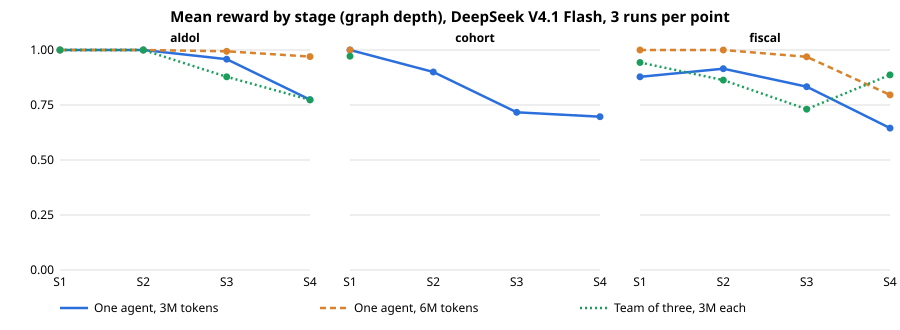

# CollabBench Graphs: long dependent task chains on real data

> **Overview (human-written):** _TODO: the hackathon requires this paragraph to be written entirely by a person._

## What it tests

Each task is a **real dependency graph (DAG) of sub-tasks** taken from one real domain. A node's output is the input of
the nodes after it, so one early mistake can spoil everything downstream, as in real analysis work.

| Graph | Domain | Nodes | Source of truth |
|---|---|---|---|
| `aldol` | organic chemistry (aldol reaction data and derivations) | 30 | real published data, deterministic derivations |
| `cohort` | demography (cohort life tables) | 4 stages | real mortality tables |
| `fiscal` | US Treasury debt (auctions, stock, TIPS accrual, maturity wall) | 30 | TreasuryDirect / Fiscal Data snapshots, validated against Treasury's own published figures |
| `poe` | software (real history of the `poethepoet` task runner, v0.33.0 to v0.45.0) | 15 units in stage 1 | the upstream pull requests and their tests |

Everything an agent needs (data, conventions and definitions) is in the task's workspace (`environment/workspace/docs`,
`data`). Tests, reference outputs and the solution never enter the agent's container. Grading happens in a separate
verifier container after the agent stops, and the agent has no network.

### Stages: difficulty by depth
Each graph is released in **4 cumulative stages**. Stage *k* contains every node up to depth level *k*, so stage 4 is
the full graph. That turns one graph into a difficulty curve: how far down a chain of dependent steps can a model stay
correct?

### Propagated grading
- **Score:** each node is scored as the fraction of its checks that pass. The reward is the mean node score.
- **Conditional score (`cond_<node>`):** recomputes the node's reference **from the agent's own upstream outputs**, which
  separates "this step was done wrong" from "this step inherited an upstream error".
- **Per-node extras:** `req_<node>` and `fam_<node>_<family>` show *which* part of a long task failed.
- **Code graph:** each unit is a real upstream PR. Pinned tests fail before the PR and pass after it, and a no-regression
  gate requires every test that passed before to still pass.
- **No LLM judge:** all checks are deterministic, using tolerances, exact matches or test outcomes.

## Results so far

**Frontier models (in progress):** Claude Opus 5.5 and GPT-6.1 sol (reasoning effort high) are running on the four
hardest tasks (aldol S4, cohort S4, fiscal S4, poe S1). Each model runs as one agent and as a team of three, with the
same 3M-token budget per agent. Results will be added here as they finish.

The calibration runs below use **DeepSeek V4.1 Flash** in our own harness, with 3 runs per cell. Cells with fewer
than 3 finished runs are marked *running*.



| Graph | Condition | S1 | S2 | S3 | S4 |
|---|---|---|---|---|---|
| aldol | one agent, 3M tokens | 1.00 | 1.00 | 0.96 | 0.77 |
| aldol | one agent, 6M tokens | 1.00 | 1.00 | 0.99 | 0.97 |
| aldol | team of three (lead + 2) | 1.00 | 1.00 | 0.88 | 0.77 |
| cohort | one agent, 3M tokens | 1.00 | 0.90 | 0.72 | 0.70 |
| cohort | one agent, 6M tokens | 1.00 | running | running | running |
| cohort | team of three | 0.97 | running | running | running |
| fiscal | one agent, 3M tokens | 0.88 | 0.92 | 0.83 | 0.65 |
| fiscal | one agent, 6M tokens | 1.00 | 1.00 | 0.97 | 0.80 |
| fiscal | team of three | 0.94 | 0.86 | 0.73 | 0.89 |
| poe | one agent, 3M tokens | 0.20 | | | |

Raw numbers, including each run, are in `results/deepseek_results.json`.

### Team metrics (planned in the design spec)
The full score table is in [`results/team_metrics.md`](results/team_metrics.md). `results/team_metrics.py` generates it
from the run logs, and every cell shows its n. It covers:
- **Outcome:** collaboration gain (team minus one agent), budget-matched gain (team vs one agent with double budget),
  interaction gain (team minus the expected best of 3 independent single-agent runs).
- **Integrity:** report fidelity (no report, false success, say-do accuracy), liveness (deadlock, loop, overrun),
  unauthorized actions.
- **Process:** uptake, critical-path ratio, redundancy, lead token share.
- **Cost:** tokens and minutes.

**Headline (DeepSeek, the 9 tasks with team runs, 3 runs per cell):**

| Condition | Mean reward |
|---|---|
| Team of three | 0.894 |
| One agent | 0.889 |
| One agent, double budget | 0.970 |

- The team beats double budget only on fiscal S4 (+0.09).
- On 7 of 9 tasks the team is below the best of three independent single-agent runs.
- Teams mostly spawn one or two "verifier" or "auditor" helpers, with little uptake of each other's work.
- When agents write a final report, they usually claim success even when the reward is below 1.
- Unauthorized actions: 0 in every cell.

### Failure modes the benchmark exposes
- **Depth breaks models.** Shallow stages are solved, but scores fall as the chain gets longer. On fiscal and aldol,
  every single-agent run below 1.00 ran to within 5% of its token budget.
- **Teams of agents do not automatically help.** On aldol the lead agent builds every node itself and spawns only
  "reviewers"; in 2 of 3 stage-3 runs it spawned no one, and the team scores below a single agent. On fiscal the leads
  split the building work, and on the hardest stage (S4) the team beats a single agent with double budget (0.89 vs 0.80).
- **Real code is harder than it looks.** On `poe` stage 1 every run keeps all 212 regression tests green, but 2 of 3 runs
  implement none of the 5 scored upstream changes (reward 0.0).
- **The benchmark audits itself.** When all 8 runs converged on the same "wrong" answer for one fiscal node, the cause was
  an undocumented step in our reference. We removed it, documented the one remaining convention (Federal Reserve
  holidays), and re-graded the finished runs offline from their result files only.

## How to run

Every folder in `tasks/` is a standard **Harbor** task: `task.toml`, `instruction.md`, `environment/Dockerfile`,
`tests/test.sh` and `solution/solve.sh`. On [Valkyrie](https://docs.valkyrie.vals.ai):

```bash
uv tool install valkyrie-cli
valkyrie login
valkyrie dataset push collabbench/graphs ./tasks --tag v1

# one task first, then scale up
valkyrie run start --agent claude_code-v1.0.0 \
  --dataset collabbench/graphs@v1 --task-ids aldol-s4 \
  --model anthropic/claude-sonnet-4-6 --provider modal \
  -s ANTHROPIC_API_KEY anthropic-api-key --concurrency 1 --connect
```

`tests/test.sh` writes `/logs/verifier/reward.json`. It holds the headline `reward` plus numeric per-node keys
(`req_*`, `score_*`, `cond_*`, `fam_*`). Running `solution/solve.sh` (Valkyrie's `oracle` agent) scores 1.0, and the
untouched start state scores 0.0.

## Layout
```
tasks/<graph>-s<stage>/   Harbor task folders (13 so far: aldol, cohort, fiscal S1–S4; poe S1)
results/                  calibration results (JSON) and the depth-curve chart
```
