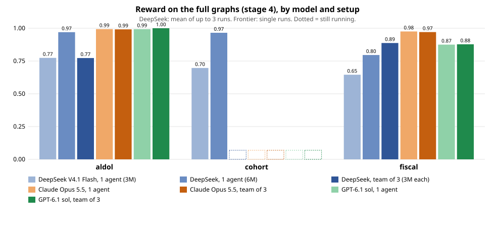

# CollabBench Graphs: long dependent task chains on real data

> **Overview (human-written):** _TODO: the hackathon requires this paragraph to be written entirely by a person._

## What it tests

Each task is a **real dependency graph (DAG) of sub-tasks** taken from one real domain. A node's output is the input of
the nodes after it, so one early mistake can spoil everything downstream, as in real analysis work.

| Graph | Domain | Nodes | Source of truth |
|---|---|---|---|
| `aldol` | organic chemistry (aldol reaction data and derivations) | 30 | real published data, deterministic derivations |
| `cohort` | demography (cohort life tables) | full graph | real mortality tables |
| `fiscal` | US Treasury debt (auctions, stock, TIPS accrual, maturity wall) | 30 | TreasuryDirect / Fiscal Data snapshots, validated against Treasury's own published figures |
| `poe` | software (real history of the `poethepoet` task runner, from v0.33.0 on) | first 15 upstream changes | the upstream pull requests and their tests |

Everything an agent needs (data, conventions and definitions) is in the task's workspace (`environment/workspace/docs`,
`data`). Tests, reference outputs and the solution never enter the agent's container. Grading happens in a separate
verifier container after the agent stops, and the agent has no network.

### How the tasks were built
Each graph was built and validated in cumulative stages by depth. The released tasks are the **full graphs** (stage 4,
hence the `-s4` folder names). `poe-s1` is the first part of the poethepoet graph (its first 15 upstream changes); the
full version is still being validated.

### Propagated grading
- **Score:** each node is scored as the fraction of its checks that pass. The reward is the mean node score.
- **Conditional score (`cond_<node>`):** recomputes the node's reference **from the agent's own upstream outputs**, which
  separates "this step was done wrong" from "this step inherited an upstream error".
- **Per-node extras:** `req_<node>` and `fam_<node>_<family>` show *which* part of a long task failed.
- **Code graph:** each unit is a real upstream PR. Pinned tests fail before the PR and pass after it, and a no-regression
  gate requires every test that passed before to still pass.
- **No LLM judge:** all checks are deterministic, using tolerances, exact matches or test outcomes.

## Results so far

**Frontier models (in progress):** Claude Opus 5.5 and GPT-6.1 sol (reasoning effort high) are running on the four
hardest tasks (aldol S4, cohort S4, fiscal S4, poe S1). Each model runs as one agent and as a team of three, with the
same 3M-token budget per agent. Results are added here as they finish; each row is one run.

<!-- FRONTIER:START -->
| Model | Task | Setup | Reward | Tokens | Minutes | Agents active | Checks missed |
|---|---|---|---|---|---|---|---|
| Claude Opus 5.5 | aldol-s4 | one agent | **0.993** | 0.39M | 6 | 1 | x5 |
| Claude Opus 5.5 | aldol-s4 | team of three | **0.992** | 0.67M | 7 | 1 | p1, x5 |
| Claude Opus 5.5 | cohort-s4 | one agent | *running* | | | | |
| Claude Opus 5.5 | cohort-s4 | team of three | *running* | | | | |
| Claude Opus 5.5 | fiscal-s4 | one agent | **0.975** | 1.28M | 10 | 1 | R2, p6 |
| Claude Opus 5.5 | fiscal-s4 | team of three | **0.971** | 0.92M | 9 | 2 | R2, p6 |
| Claude Opus 5.5 | poe-s1 | one agent | *running* | | | | |
| Claude Opus 5.5 | poe-s1 | team of three | *running* | | | | |
| GPT-6.1 sol (high) | aldol-s4 | one agent | **0.993** | 0.28M | 6 | 1 | R1, x2 |
| GPT-6.1 sol (high) | aldol-s4 | team of three | **1.000** | 1.20M | 6 | 3 | none |
| GPT-6.1 sol (high) | cohort-s4 | one agent | *running* | | | | |
| GPT-6.1 sol (high) | cohort-s4 | team of three | *running* | | | | |
| GPT-6.1 sol (high) | fiscal-s4 | one agent | *running* | | | | |
| GPT-6.1 sol (high) | fiscal-s4 | team of three | *running* | | | | |
| GPT-6.1 sol (high) | poe-s1 | one agent | *running* | | | | |
| GPT-6.1 sol (high) | poe-s1 | team of three | *running* | | | | |
<!-- FRONTIER:END -->

On aldol both frontier models nearly solve the task. Opus 5.5's team lead did all the work itself; GPT-6.1 sol's team
used all three agents and is the only run with a perfect score. Check x5 is missed by Opus and by every DeepSeek run.



**DeepSeek V4.1 Flash** (our harness; mean of 3 runs, n shown where fewer):

| Task | One agent, 3M tokens | One agent, 6M tokens | Team of three, 3M each |
|---|---|---|---|
| aldol | 0.77 | 0.97 | 0.77 |
| cohort | 0.70 | 0.97 | running |
| fiscal | 0.65 | 0.80 | 0.89 |
| poe (first 15 changes) | 0.20 | 0.27 | running |

Raw numbers, including each run, are in `results/deepseek_results.json`.

### Team metrics (planned in the design spec)
The full score table is in [`results/team_metrics.md`](results/team_metrics.md). `results/team_metrics.py` generates it
from the run logs, and every cell shows its n. It covers:
- **Outcome:** collaboration gain (team minus one agent), budget-matched gain (team vs one agent with double budget),
  interaction gain (team minus the expected best of 3 independent single-agent runs).
- **Integrity:** report fidelity (no report, false success, say-do accuracy), liveness (deadlock, loop, overrun),
  unauthorized actions.
- **Process:** uptake, critical-path ratio, redundancy, lead token share.
- **Cost:** tokens and minutes.

**Headline (DeepSeek, 3 runs per cell):**
- On fiscal the team beats both a single agent (0.89 vs 0.65) and a single agent with double budget (0.80).
- On aldol the team equals a single agent (0.77) and loses to double budget (0.97).
- DeepSeek teams mostly spawn one or two "verifier" or "auditor" helpers, with little uptake of each other's work.
- When agents write a final report, they usually claim success even when the reward is below 1.
- Unauthorized actions: 0 in every cell.

### Failure modes the benchmark exposes
- **Long dependent chains break models.** On the full graphs, DeepSeek's single-agent runs score 0.65–0.77, and every
  run below 1.00 ran to within 5% of its token budget.
- **Teams of agents do not automatically help.** On aldol the lead agent builds every node itself and spawns only
  "reviewers" (DeepSeek), or no one at all (Opus 5.5). On fiscal the DeepSeek leads split the building work, and the
  team beats a single agent with double budget (0.89 vs 0.80).
- **Real code is harder than it looks.** On `poe` stage 1 every run keeps all 212 regression tests green, but 2 of 3 runs
  implement none of the 5 scored upstream changes (reward 0.0).
- **The benchmark audits itself.** When all 8 runs converged on the same "wrong" answer for one fiscal node, the cause was
  an undocumented step in our reference. We removed it, documented the one remaining convention (Federal Reserve
  holidays), and re-graded the finished runs offline from their result files only.

## How to run

Every folder in `tasks/` is a standard **Harbor** task: `task.toml`, `instruction.md`, `environment/Dockerfile`,
`tests/test.sh` and `solution/solve.sh`. On [Valkyrie](https://docs.valkyrie.vals.ai):

```bash
uv tool install valkyrie-cli
valkyrie login
valkyrie dataset push collabbench/graphs ./tasks --tag v1

# one task first, then scale up
valkyrie run start --agent claude_code-v1.0.0 \
  --dataset collabbench/graphs@v1 --task-ids aldol-s4 \
  --model anthropic/claude-sonnet-4-6 --provider modal \
  -s ANTHROPIC_API_KEY anthropic-api-key --concurrency 1 --connect
```

`tests/test.sh` writes `/logs/verifier/reward.json`. It holds the headline `reward` plus numeric per-node keys
(`req_*`, `score_*`, `cond_*`, `fam_*`). Running `solution/solve.sh` (Valkyrie's `oracle` agent) scores 1.0, and the
untouched start state scores 0.0.

## Layout
```
tasks/                    Harbor task folders: aldol-s4, cohort-s4, fiscal-s4 (full graphs), poe-s1 (first part)
results/                  results (JSON), the chart, the team-metrics table and the scripts that build them
```
